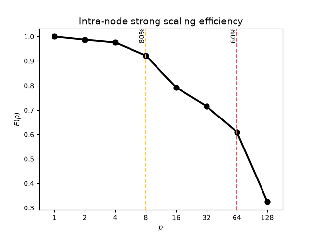
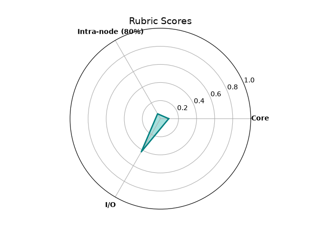

# SHAREing: High-level performance assessment report

**Code assessed:** Random Forest regression of halo gas density profiles in the EAGLE simulations
(Python, scikit-learn), on COSMA8.

> [!NOTE]
> This report follows the SHAREing high-level template. Every number comes from a Slurm job whose
> scripts are in [`scripts/`](scripts/) and whose raw output is in [`results/`](results/). "Method
> notes" explain choices that are not obvious from the guidebook, and
> [Appendix A](#appendix-a-tooling-notes-for-cosma8) records what did not work on COSMA8 and how it
> was worked around, so the report can also serve as a worked example.

As recommended in the [pre-assessment](pre-assessment-report.md), the high-level assessment was
performed by Fawada Qaiser (DiRAC / Durham University) between 18 October 2026 and 21 October 2026.

The submitter's code uses neither MPI nor GPUs, so out of the five performance dimensions, the ones
relevant to this assessment and benchmark are:

- [x] [Core-level assessment](#2-core-level-assessment)
- [x] [Intra-node assessment](#3-intra-node-assessment)
- [x] [I/O assessment](#6-io-assessment)

The inter-node and GPU dimensions are not applicable (Sections [4](#4-inter-node-assessment) and
[5](#5-gpu-performance-assessment)).

We provide brief explanations of the high-level metrics in their relevant sections. However, for a
more detailed description, please refer to Chapter 5 in
the [performance assessment guidebook](https://shareing-dri.github.io/assets/pdfs/perf_analysis_workbook_brief.pdf).

## Table of contents

- [SHAREing: High-level performance assessment report](#shareing-high-level-performance-assessment-report)
    - [Table of contents](#table-of-contents)
    - [1. Setup Details](#1-setup-details)
        - [1.1 Programming model](#11-programming-model)
        - [1.2 SLURM configuration](#12-slurm-configuration)
        - [1.3 Base input](#13-base-input)
        - [1.4 Jobs and correctness check](#14-jobs-and-correctness-check)
    - [2. Core-level assessment](#2-core-level-assessment)
    - [3. Intra-node assessment](#3-intra-node-assessment)
    - [4. Inter-node assessment](#4-inter-node-assessment)
    - [5. GPU-performance assessment](#5-gpu-performance-assessment)
    - [6. I/O Assessment](#6-io-assessment)
    - [7. Summary](#7-summary)
    - [8. High-level assessment outcome](#8-high-level-assessment-outcome)
    - [Appendix A: Tooling notes for COSMA8](#appendix-a-tooling-notes-for-cosma8)
    - [Appendix B: Reproducing this assessment](#appendix-b-reproducing-this-assessment)

## 1. Setup Details

The code is Python and is not compiled. As in the pre-assessment, the owner's script was not run
directly, because it hard-codes the owner's directories; the benchmark harness
[`scripts/rf_benchmark.py`](scripts/rf_benchmark.py) performs the same computation (same data,
cuts, transforms, split and forest settings) with configurable paths, per-phase timing and
optional outputs. Two things differ from the pre-assessment runs, both to follow the guidebook:

- threads were **pinned to physical cores** for the intra-node and I/O measurements (the
  pre-assessment sweep was unpinned);
- the core measurement was made on **one thread pinned to one core** under `likwid-perfctr`.

### 1.1 Programming model

The code uses **shared-memory threads within one process** (scikit-learn's `RandomForestRegressor`,
parallelised with joblib threads). The tree-building code is compiled (Cython) and releases Python's
global interpreter lock, so threads build trees genuinely in parallel. There is no MPI and no GPU
code, so a single process with `n_jobs` threads was used for every run.

| Software | Version |
|---|---|
| Python | 3.12.4 (virtual environment, pip wheels) |
| scikit-learn / joblib | 1.9.1 / 1.6.0 |
| numpy / h5py / scipy / matplotlib | 2.5.4 / 3.16.0 / 1.18.1 / 3.11.2 |

### 1.2 SLURM configuration

All analyses were performed on an exclusive node on COSMA8 (2 × AMD EPYC 7H12, 64 cores each:
128 physical cores, 2 hardware threads per core (SMT), 8 NUMA domains of 16 cores, 1006 GiB RAM)
with the following configuration:

```bash
#SBATCH --partition=cosma8
#SBATCH --account=<project_account>
#SBATCH --nodes=1
#SBATCH --ntasks=1
#SBATCH --exclusive
```

Other settings common to all runs:

```bash
source ~/venvs/eagle-rf/bin/activate
export OMP_NUM_THREADS=1 OPENBLAS_NUM_THREADS=1 MKL_NUM_THREADS=1   # no extra BLAS threads
taskset -c "$(python3 scripts/cpulist.py compact <p>)" ...          # pin to p physical cores
module load gnu_comp/14.1.0 likwid/5.5.1                            # core rubric only
```

> [!NOTE]
> **Method note: build CPU lists on the compute node.** COSMA8 login nodes number their CPUs
> differently from compute nodes (alternating sockets, no SMT), so pinning lists prepared on a
> login node would be wrong. [`scripts/cpulist.py`](scripts/cpulist.py) reads `lscpu -p` on the
> node where the job runs and returns one hardware thread per physical core, filling one NUMA
> domain before the next ("compact").

### 1.3 Base input

The following is the input configuration used for all runs (`n_jobs` varies per rubric):

```txt
Simulation      EAGLE L0100N1504, z = 0   (eagle_z0.hdf5, 85 MB)
Haloes          60,039 after cuts: 48,031 training / 12,008 test (80/20 split, random_state=1)
Features        6 global galaxy and halo properties
Targets         9 radial bins of the gas density profile (0.05-1 R200c)
Forest          n_estimators=1000, max_depth=32, min_samples_split=2, max_features='sqrt', random_state=1
Command         python3 rf_benchmark.py 0100 1504 0 --n-jobs <threads> --n-estimators 1000 [--save-model --save-arrays --plot]
```

Timed region: training (`fit`) for the intra-node rubric; the whole program for the core and I/O
rubrics.

### 1.4 Jobs and correctness check

| Slurm job | Script | What it measured |
|---|---|---|
| 12187670 | [`run_highlevel.sh`](scripts/run_highlevel.sh) | Node topology; pinned intra-node sweep; SMT run; NUMA check; I/O with outputs on RAM / Lustre / VAST |
| 12188095 | [`run_followup.sh`](scripts/run_followup.sh) | Core rubric (LIKWID) |
| 12191857 | `run_followup.sh` with `RUN_CORE=0` | Darshan attempt (failed; Section 6) |
| two jobs, 21 Oct | [`run_strace.sh`](scripts/run_strace.sh) | I/O rubric with `strace` (1 pair, then 3 alternating repeats) |
| 12186032 + 12187354 | [`run_scaling.sh`](scripts/run_scaling.sh) | Earlier unpinned sweep, for comparison only |

**Correctness:** with a fixed random seed, the trained forest is bit-for-bit identical at every
thread count. The harness hashes every tree; all runs reported here produced the same hash
(`5590010f3e7cacbb`), so every timing compares the same computation.

## 2. Core-level assessment

For a high-level analysis of a single core's performance, we look for the floating-point operation
rate compared to the theoretical rate, $R^{core}_{theoretical}$ for a core. The hardware capabilities
were determined with `likwid-bench` pinned to a single core on the first socket of a compute node
(the 32 kB L1 data cache gives a 16 kB working set):

```bash
likwid-bench -t peakflops -w S0:16kB:1
```

To analyse the performance of a single core, the code was run on one thread pinned to the first
core with `likwid-perfctr` to get the observed floating point rate, with the
[input indicated earlier](#13-base-input):

```bash
likwid-perfctr -f -C 0 -g FLOPS_DP python3 rf_benchmark.py 0100 1504 0 --n-jobs 1 --n-estimators 1000
```

The observed and theoretical floating point rates were:

| Metric                   | MFLOPS  |
|--------------------------|---------|
| $R^{core}_{theoretical}$ | 9,012.9 |
| $R^{core}_{observed}$    | 827.1   |

Based on these results, we determined that this software has a score
of $C^{core} = \frac{R_{observed}}{R_{theoretical}} = \frac{827.1}{9012.9}\approx$ `0.092`. As per
the rubric, the metric is classified as follows:

| Peak FLOPS proportion      | Description                                                                                                                                                              | Score                              |
|----------------------------|--------------------------------------------------------------------------------------------------------------------------------------------------------------------------|------------------------------------|
| $C_{core} \ge$ 0.8         | <span style="background-color: #0080005f">Core performance does not require further analysis.</span>                                                                     |                                    |
| 0.8 $\gt C_{core} \ge$ 0.6 | <span style="background-color: #ffff005c">Core performance may require further analysis as it may not be effectively using the hardware to its maximum potential.</span> |                                    |
| 0.6 $\gt C_{core}$         | <span style="background-color: #ff00004e">Core performance requires in-depth analysis.</span>                                                                            | $C_{core} \approx$ `0.092` |

**Context.** The score is low largely because of what the metric measures. The same counter run
recorded:

| Quantity (serial run, 118.4 s) | Value |
|---|---|
| Floating-point operations | 97.9 × 10⁹ |
| Instructions retired | 699.1 × 10⁹ |
| Cycles | 393.1 × 10⁹ (≈ 3.3 GHz; the core was boosting) |
| Instructions per cycle | **1.78** |
| Floating-point operations per instruction | 0.14 |
| AVX peak / AVX FMA peak, one core (context only) | 51,430 / 55,967 MFLOPS |

The core is busy (1.78 instructions per cycle), but only about one instruction in seven is a
floating-point operation. Building a decision tree means sorting candidate thresholds, comparing
values, branching and moving data; the arithmetic is mainly the running sums used to score each
candidate split. A FLOP-based metric rates such a code as poor however well it is implemented, so
this result reflects a limitation of the core metric for tree-based machine learning as much as the
code. Training was 94% of the measured run (106.9 s of 113.8 s); the rest is start-up, reading,
prediction and exit, which the whole-program measurement includes.

> [!WARNING]
> **Method note: do not add `FLOPS_DP` and `FLOPS_SP` on this processor.** On AMD Zen 2, LIKWID's
> `FLOPS_DP` and `FLOPS_SP` groups both read the same all-precision event,
> `RETIRED_SSE_AVX_FLOPS_ALL`. The two runs counted 97,911,365,675 and 97,911,365,533 operations
> (a difference of 142); their *rates* differed by 2.5% only because the runs took slightly
> different times. Adding them would double the score to 0.186. Compare total counts
> (rate × runtime), or the event names in LIKWID's output, before adding. LIKWID's group
> definitions use the same combined event on Zen 2, Zen 3, Zen 4 and Zen 4c; first-generation Zen,
> Zen 5 and recent Intel Xeons have separate double- and single-precision events.

## 3. Intra-node assessment

For a high-level analysis of the intra-node performance, we perform a strong scaling by fixing the
problem size and increasing core allocation. The [base input](#13-base-input) was trained with
`n_jobs` = p threads, the process restricted with `taskset` to p physical cores (one hardware
thread each, filling one NUMA domain before the next). Each point was run three times; the table
gives the median training time. Efficiency is calibrated against the 1-thread run.

| Cores | Ranks | Thread per rank | Time (s) | Parallel efficiency (%) |
|-------|-------|-----------------|----------|-------------------------|
| 1     | 1     | 1               | 106.45   | 100.0                   |
| 2     | 1     | 2               | 53.92    | 98.7                    |
| 4     | 1     | 4               | 27.26    | 97.6                    |
| 8     | 1     | 8               | 14.42    | 92.3                    |
| 16    | 1     | 16              | 8.40     | 79.2                    |
| 32    | 1     | 32              | 4.65     | 71.5                    |
| 64    | 1     | 64              | 2.73     | 60.9                    |
| 128   | 1     | 128             | 2.56     | 32.5                    |



*Graph and critical points produced with the `assessmenttemplate` package (v1.2; categorical plot
with critical points) from [`results/times_pinned.csv`](results/times_pinned.csv); see
[`scripts/make_report_plots.py`](scripts/make_report_plots.py).*

The 80% threshold is at `8` cores and the 60% threshold is at `64` cores. As a proportion of the
number of cores available on the node i.e. `128`, the scores are:

$$
C^{80\\\%}_{intra}=\frac{p^{80\\\%}_{critical,intra}}{p_{max,intra}}=\frac{\texttt{8}}{\texttt{128}}=\texttt{6.25}\\\%
$$

and

$$
C^{60\\\%}_{intra}=\frac{p^{60\\\%}_{critical,intra}}{p_{max,intra}}=\frac{\texttt{64}}{\texttt{128}}=\texttt{50.0}\\\%
$$

| Efficiency                                                   | Description                                                                                                                                                                   | Score                                                                          |
|--------------------------------------------------------------|-------------------------------------------------------------------------------------------------------------------------------------------------------------------------------|--------------------------------------------------------------------------------|
| $C^{80\\\%}_{intra} \ge$ 0.8                                 | <span style="background-color: #0080005f">Shared memory scaling does not require further analysis.</span>                                                                     |                                                                                |
| $C^{80\\\%}_{intra} \lt$ 0.8 ^ $C^{60\\\%}\_{intra} \ge$ 0.6 | <span style="background-color: #ffff005c">Shared memory scaling may require analysis; scaling performance may be impacted when porting to newer chips with more cores.</span> |                                                                                |
| otherwise                                                    | <span style="background-color: #ff00004e">Shared memory scaling requires in-depth analysis.</span>                                                                            | $C^{80\\\%}_{intra} \approx$ `0.0625` & $C^{60\\\%}\_{intra} \approx$ `0.50` |

**Context.**

- **The classification is robust.** p⁸⁰ lies between 8 and 16 cores (16 cores gives 79.2%, just
  under the threshold) and p⁶⁰ between 64 and 128. Measuring intermediate core counts would refine
  the scores but cannot change the classification: the middle band would need 60% efficiency on at
  least 77 cores, and the top band 80% efficiency on at least 103.
- **Training stops getting faster at about 2.5 s.** 128 cores is only 7% faster than 64. Using all
  256 hardware threads (both SMT threads per core) gave 2.58 s, no faster than 128 cores.
- **Pinning helps.** Absolute training times were 3–12% shorter than in the earlier unpinned sweep
  at every core count (e.g. 106.5 s vs 121.0 s serial; 2.73 s vs 3.01 s on 64 cores). The pinned
  efficiencies look slightly lower only because the serial reference improved the most. The two
  sweeps ran on different nodes, so part of the difference may be node-to-node variation.
- **NUMA placement is not the main limit.** 16 threads in one NUMA domain took 8.41 s; the same 16
  spread across all eight domains took 8.69 s, only 3% slower.
- **Untested hypotheses for the low-level stage:** (1) *load imbalance*: 1000 trees on 128 cores is
  about 8 trees per core and trees differ in size, so some threads finish early and wait; (2) *fixed
  overhead*: joblib dispatches trees and gathers results from one Python thread, which does not
  shrink with more cores and matters when training takes ~2.5 s.
- **For the owner:** their choice of 16 threads (79% efficiency) is close to the most efficient
  setting; 64 threads trains three times faster at 61% efficiency.

## 4. Inter-node assessment

Not applicable. The code has no MPI or other means of running across nodes, so this rubric receives
no score. It is reported as *not applicable*, not as zero.

## 5. GPU-performance assessment

Not applicable. The code runs only on CPUs.

## 6. I/O Assessment

For the I/O performance, we look for the proportion of the runtime spent processing I/O requests.
The code was run with the owner's full I/O behaviour (saving the trained model, four train/test
arrays and a PDF figure) on 16 pinned cores, the owner's thread count, writing to Lustre
(`/cosma8`), the owner's filesystem type.

**On COSMA8, the I/O metrics could not be obtained with `darshan` for this code.** COSMA8's
`darshan-runtime/3.4.6` is built with HDF5 support, and Python crashes as soon as the code opens its
HDF5 input with pip's `h5py`, which bundles its own HDF5 library. The configuration that came closest:

```shell
module load gnu_comp/14.1.0 openmpi/5.0.3 darshan-runtime/3.4.6 darshan-util/3.4.6
export DARSHAN_ENABLE_NONMPI=1
export DARSHAN_MOD_DISABLE=H5F,H5D            # otherwise Python fails at start-up
mkdir -p darshan_logs/$(date +%Y/%-m/%-d)     # darshan does not create its dated folders
DARSHAN_LOGPATH=darshan_logs LD_PRELOAD=${DARSHAN_DIR}/lib/libdarshan.so $EXEC $INPUT
# -> python3: symbol lookup error: .../libdarshan.so: undefined symbol: H5get_libversion
```

| Metric                     | Time(s)                     |
|----------------------------|-----------------------------|
| `total_POSIX_F_READ_TIME`  | not obtainable (see above)  |
| `total_POSIX_F_WRITE_TIME` | not obtainable (see above)  |

The same quantities, the wall-clock time spent inside read and write system calls, were therefore
measured with `strace`, a standard Linux tool that wraps any program without changes. `-w` is
essential: without it `strace -c` reports CPU time and omits time spent waiting for the filesystem.

```shell
strace -f -c -w -e trace=read,write,pread64,pwrite64,readv,writev,openat,close,fsync,lseek $EXEC $INPUT
```

Runs with and without `strace` were alternated three times. The following relevant I/O metrics were
extracted (median repeat shown; all repeats below):

| Metric (`strace -c -w`, Lustre)             | Time(s) |
|---------------------------------------------|---------|
| read + pread64 + readv (`t_read`)           | 0.07    |
| write + pwrite64 + writev (`t_write`)       | 22.28   |
| total runtime under `strace` (`t_total`)    | 38.76   |

The I/O score, $C_{I/O}$, was computed as follows:

$$
C_{I/O}=1.0-\frac{t_{read} + t_{write}}{t_{total}}=1.0-\frac{0.07+22.28}{38.76}=\texttt{0.42}
$$

| I/O proportion            | Description                                                                                                                          | Score                          |
|---------------------------|--------------------------------------------------------------------------------------------------------------------------------------|--------------------------------|
| $C_{I/O} \ge$ 0.8         | <span style="background-color: #0080005f">I/O does not require further analysis.</span>                                              |                                |
| 0.8 $\gt C_{I/O} \ge$ 0.6 | <span style="background-color: #ffff005c">I/O forms a significant part of the total runtime and may require further analysis.</span> |                                |
| 0.6 $\gt C_{I/O}$         | <span style="background-color: #ff00004e">I/O requires in-depth analysis.</span>                                                     | $C_{I/O} \approx$ `0.42` (median; 0.28–0.55 over 9 runs) |

**Context.**

- **Writing the 7.3 GB model dominates.** Converting the model to bytes (pickling) takes about
  1.1 s; writing those bytes to Lustre took 13.6–35.9 s. Reading the 85 MB input takes 0.01–0.08 s.
  The model is large because the trees are almost fully grown (53.7 million nodes).
- **Lustre's write speed varies by a factor of 2.6 between runs** (about 200–540 MB/s), even minutes
  apart on the same node, because `/cosma8` is shared by all COSMA8 users. C_I/O is therefore given
  as a median and range; it was below 0.6 in every one of the 9 runs, so the classification holds.
- **`strace` is a workable fallback for Darshan.** It was cross-checked against an independent
  measurement: in every run, the harness's save time minus `strace`'s write time is ~1.1 s
  (pickling). Its overhead could not be separated from Lustre's variation: the median total was
  17% higher with `strace`, but plain runs alone varied by 50%, and in one pair the `strace` run
  was faster.
- **A second, independent method gives the same picture.** Saving the same outputs to RAM
  (`/dev/shm`, no filesystem), Lustre and VAST (job 12187670, medians of 2): save time 3.2 s, 37.0 s
  and 67.0 s; total 15.8 s, 49.4 s and 79.8 s.

All 9 measured runs on Lustre (for runs without `strace`, t_write = save time − 1.1 s):

| Run | t_write (s) | Write speed | t_total (s) | C_I/O |
|---|---|---|---|---|
| Job 12187670, median of 2 | 35.8 | 204 MB/s | 49.43 | 0.28 |
| `strace` pair, plain / with `strace` | 35.9 / 13.6 | 203 / 537 MB/s | 54.77 / 30.59 | 0.34 / 0.55 |
| `strace` repeats 1–3, plain | 18.7 / 14.8 / 29.5 | 390 / 493 / 247 MB/s | 33.13 / 28.71 / 43.01 | 0.44 / 0.48 / 0.31 |
| `strace` repeats 1–3, with `strace` | 30.1 / 22.3 / 19.4 | 243 / 328 / 377 MB/s | 46.93 / 38.76 / 35.99 | 0.36 / 0.42 / 0.46 |

Raw output: [`results/strace_summary.md`](results/strace_summary.md),
[`results/highlevel_12187670_summary.md`](results/highlevel_12187670_summary.md).

## 7. Summary

The following table collates the results of all above sections. These scores are indicative only,
and cannot truly be compared to one another meaningfully without taking into account domain
knowledge and methodological differences between them.

| Result                                       | Score    | Metric result                                  |
|----------------------------------------------|----------|------------------------------------------------|
| [Core](#2-core-level-assessment)             | `0.092`  | 827.1 MFLOPS                                   |
| [Intra-node (80%)](#3-intra-node-assessment) | `0.0625` | 8 core(s)                                      |
| [Inter-node (80%)](#4-inter-node-assessment) | n/a      | not applicable                                 |
| [GPU](#5-gpu-performance-assessment)         | n/a      | not applicable                                 |
| [I/O](#6-io-assessment)                      | `0.42`   | 22.3 s of 38.8 s in read/write (median of 3)   |



*Spiderweb produced with the `assessmenttemplate` package's `summary_to_spiderweb` from
[`results/rubric_scores.csv`](results/rubric_scores.csv), with the radial axis fixed to 0–1 (the
package autoscales it to the largest score, which would make these low scores look large); see
[`scripts/make_report_plots.py`](scripts/make_report_plots.py). Not-applicable rubrics are omitted.*

## 8. High-level assessment outcome

All three applicable rubrics are classified as requiring in-depth analysis, but they are not equally
significant or actionable:

| Rubric | Significance | Suggested low-level analysis |
|---|---|---|
| **I/O** | **Highest.** Writing the model takes 44–72% of a run on Lustre, depending on filesystem load, and is the largest single cost | Ask the owner whether the full model must be saved every run; test Lustre striping (`lfs setstripe -c`) and writing to node-local memory followed by one copy; measure with Darshan if COSMA can provide a build compatible with `h5py` |
| **Intra-node** | Moderate. Training at the owner's 16 threads takes 8.4 s, so better scaling saves seconds per run; it matters more for much larger forests | Test the load-imbalance and fixed-overhead hypotheses: time individual trees, profile the dispatching thread (`py-spy`), repeat the sweep with more trees |
| **Core** | Low as a target. The metric undervalues tree-building, and the work is in scikit-learn's library code, which the owner would not normally change | If pursued: LIKWID groups for branches, caches and memory to show what limits the core |

### Advice for the code owner (not measured findings)

1. Saving the 7.3 GB model dominates each run; saving it less often is the largest available
   speed-up.
2. 16 threads is a sensible choice (79% efficiency); 64 threads trains three times faster at 61%.
3. The original script crashes at the plotting step on COSMA8 compute nodes, where LaTeX is not
   installed (see the pre-assessment report).

### Methodology findings (for the SHAREing team)

1. **The FLOP-based core metric is not informative for tree-based machine learning.** Instructions
   per cycle (here 1.78) and the floating-point share of instructions (0.14) show whether the core
   is busy.
2. **On AMD Zen 2/3/4, LIKWID's `FLOPS_DP` and `FLOPS_SP` read the same counter**, so measuring both
   must not lead to adding them. Check the event names (`likwid-perfctr -g FLOPS_DP -H`) first.
3. **COSMA8's Darshan cannot trace Python codes that read HDF5 through pip's `h5py`.**
   `strace -f -c -w` is a workable black-box substitute.
4. **I/O on a shared filesystem needs repeated runs.** Lustre's write speed varied 2.6× between runs,
   so a single run can misstate C_I/O by about ±0.15.
5. **Thread placement matters for the scaling rubric:** pinning shortened every run by 3–12%, and
   `nproc` reports hardware threads (256) rather than cores (128) on SMT nodes.
6. **`assessmenttemplate` v1.2 needs Python ≥ 3.12** (it uses nested same-quote f-strings), although
   its metadata declares ≥ 3.8; and its spiderweb autoscales the radial axis rather than fixing it
   to 0–1.

## Appendix A: Tooling notes for COSMA8

| Problem | Fix |
|---|---|
| `likwid` module will not load | `module load gnu_comp/14.1.0 likwid/5.5.1` |
| `darshan-runtime` module will not load | `module load gnu_comp/14.1.0 openmpi/5.0.3 darshan-runtime/3.4.6 darshan-util/3.4.6` |
| Darshan crashes Python at start-up | `DARSHAN_MOD_DISABLE=H5F,H5D` (still fails once `h5py` opens a file) |
| Darshan log lost when using `DARSHAN_LOGFILE` | Python starts a `uname -p` helper that takes the file name first; use `DARSHAN_LOGPATH=<dir>` |
| Darshan "unable to create log file" | Create `<dir>/YYYY/M/D` before the run |
| Darshan unusable | `strace -f -c -w -e trace=read,write,...` ([`scripts/run_strace.sh`](scripts/run_strace.sh)) |
| `strace -c` shows tiny I/O times | Add `-w` for wall-clock time |
| `peakflops` measured on a login node | Not valid: login nodes are a different processor; measure inside the job |
| Pinning lists | Build on the compute node ([`scripts/cpulist.py`](scripts/cpulist.py)) |
| `assessmenttemplate` fails with an f-string `SyntaxError` | Use Python ≥ 3.12 (COSMA8's Python 3.12.4 works) |

## Appendix B: Reproducing this assessment

```bash
cd scripts
source ~/venvs/eagle-rf/bin/activate
export EAGLE_DATA_ROOT=/path/to/eagle_data      # the owner's data directory (not published)
# set --account and the LUSTRE_DIR / VAST_DIR defaults in the job scripts
# (the scripts stop with a message if any CHANGE_ME placeholder is left), then:
sbatch run_highlevel.sh                          # ~25 min: topology, scaling, NUMA check, I/O locations
TARGET=highlevel_<jobid> sbatch run_followup.sh  # core rubric (LIKWID)
sbatch run_strace.sh                             # I/O rubric with strace, 3 alternating repeats
python3 summarise_highlevel.py highlevel_<jobid>
python3 summarise_strace.py strace_<jobid>
```

Figures (needs the `assessmenttemplate` package and Python ≥ 3.12):

```bash
pip install git+https://github.com/SHAREing-DRI/assessment-template.git
python3 scripts/make_report_plots.py             # writes images/intranode.png and images/summary.png
```
